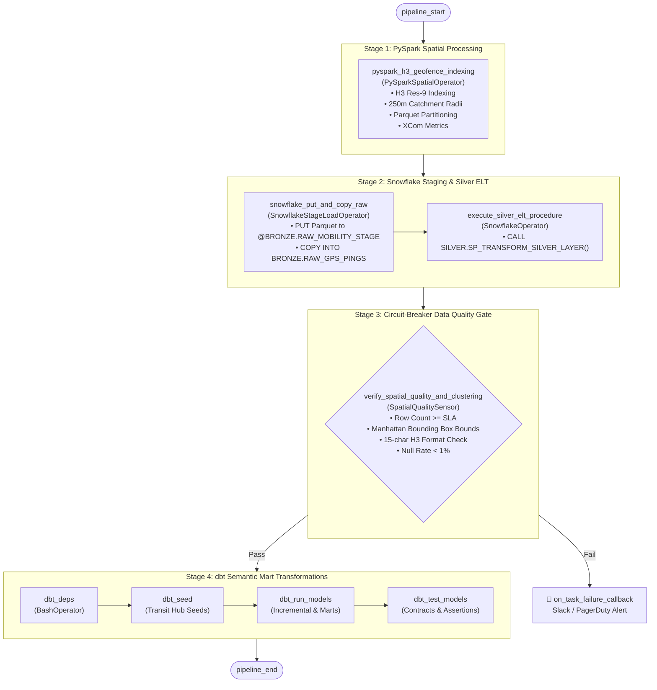
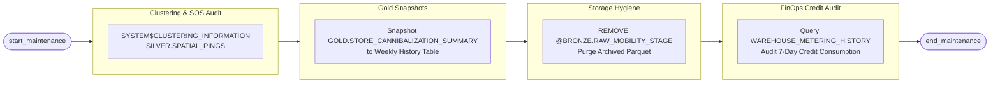

# GeoPulse Retail Mobility Analytics — Airflow Orchestration Platform

This directory contains the production-grade **Apache Airflow** orchestration workflows, custom spatial plugins, data quality circuit-breaker sensors, and automated alerting pipelines for the **GeoPulse Retail Mobility Analytics** platform.

The orchestration layer coordinates distributed **PySpark** spatial processing, **Snowflake** warehouse staging and Silver ELT procedures, automated data quality gates, and **dbt** Gold mart semantic transformations.

---

## 1. Orchestration Architecture & Workflow Topology

### Daily Pipeline (`geopulse_mobility_elt_dag`)
The primary daily workflow processes high-frequency mobile GPS telemetry across Midtown Manhattan, stages partitioned Parquet payloads into Snowflake, evaluates spatial data quality thresholds, and refreshes analytical cannibalization marts.



---

### Weekly Maintenance Workflow (`geopulse_warehouse_maintenance_dag`)
Runs every Sunday at 03:00 UTC (`0 3 * * 0`) to audit micro-partition clustering health, capture weekly store cannibalization snapshot tables, purge expired bronze stage files, and meter warehouse compute credit usage.



---

## 2. Platform Components & Custom Plugins

| Component | Path | Type | Description |
| :--- | :--- | :--- | :--- |
| **PySparkSpatialOperator** | `plugins/operators/pyspark_spatial_operator.py` | `BaseOperator` | Triggers H3 spatial indexing, validates output Parquet partition count, and pushes record counts and latency metrics to XCom. |
| **SnowflakeStageLoadOperator** | `plugins/operators/snowflake_stage_operator.py` | `BaseOperator` | Manages automated `PUT` of partitioned files to `@BRONZE.RAW_MOBILITY_STAGE` and idempotent `COPY INTO` with load assertions. |
| **SpatialQualitySensor** | `plugins/sensors/spatial_quality_sensor.py` | `BaseSensorOperator` | Automated circuit breaker checking coordinate bounds, H3 15-char hexadecimal formatting, and partition clustering health. |
| **Alert Callbacks** | `plugins/callbacks/alert_callbacks.py` | `Callbacks` | Structured Slack Block-Kit and email alerts with execution context, exception tracebacks, log URLs, and XCom spatial telemetry. |
| **init_connections.py** | `scripts/init_connections.py` | `Script` | Idempotently provisions `snowflake_geopulse_conn` and spatial variables in Airflow's metadata store. |
| **Mobility ELT DAG** | `dags/geopulse_mobility_elt_dag.py` | `DAG` | Core daily pipeline (`@daily`) orchestrating PySpark, Snowflake, quality gates, and dbt. |
| **Maintenance DAG** | `dags/geopulse_warehouse_maintenance_dag.py` | `DAG` | Weekly maintenance workflow (`0 3 * * 0`) for clustering audits and storage hygiene. |
| **Unit Test Suite** | `tests/test_dags_and_operators.py` | `pytest` | Validates DagBag import cleanliness, absence of cyclic dependencies, task counts, and operator execution. |

---

## 3. Environment & Connection Configuration

### `airflow.cfg` Highlights
- **Executor**: `LocalExecutor` for concurrent local and worker execution.
- **DAG Directory**: `./airflow/dags`
- **Plugins Directory**: `./airflow/plugins`
- **Metadata Database**: SQLite (`sqlite:///./airflow/airflow.db`) for lightweight local execution, or PostgreSQL in cloud deployments.
- **Security & Hygiene**: `load_examples = False`, `dags_are_paused_at_creation = True`, UTC timestamps.

### Initializing Connections & Variables
To seed Airflow connections and project-level variables from your environment:

```bash
python airflow/scripts/init_connections.py
```

This provisions:
- **`snowflake_geopulse_conn`**: Snowflake connection profile configured with warehouse `COMPUTE_WH`, database `GEOPULSE_DB`, and schema `SILVER`.
- **Spatial Bounding Variables**:
  - `manhattan_min_lat = 40.700000`
  - `manhattan_max_lat = 40.850000`
  - `manhattan_min_lon = -74.050000`
  - `manhattan_max_lon = -73.900000`
  - `geopulse_catchment_radius_meters = 250.0`
  - `geopulse_h3_resolution = 9`

---

## 4. Observability & Slack Alerting Format

When a task fails or misses its registered SLA, `alert_callbacks.py` compiles a structured Slack message card containing:
1. **DAG & Task Context**: Task ID, DAG run ID, logical execution date.
2. **Exception Diagnostics**: Truncated stack trace and error category.
3. **Upstream Metrics**: Total pings read, enriched ping counts, and parquet partition counts retrieved directly from XCom.
4. **Actionable Link**: One-click button navigating directly to the Airflow task log URL.

---

## 5. Local Testing & CI/CD Verification

Execute the unit test suite to validate DAG imports, schedule intervals, operator logic, and sensor circuit breakers:

```bash
# Run full Airflow unit test suite
pytest airflow/tests/test_dags_and_operators.py -v

# Run test suite with coverage
pytest airflow/tests/test_dags_and_operators.py --tb=short
```
