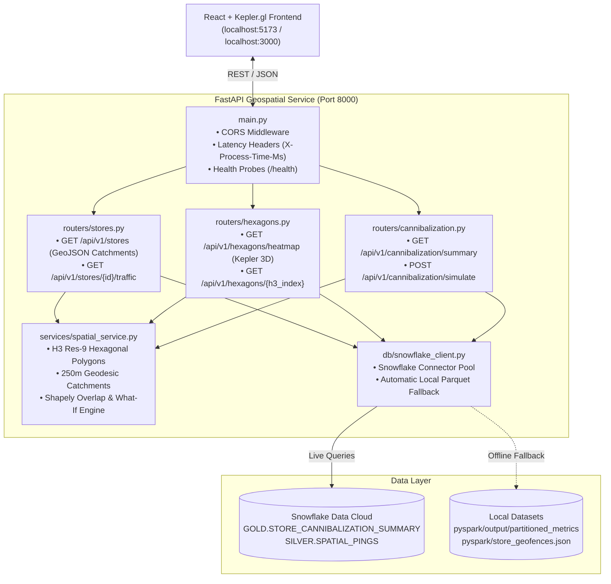

# GeoPulse Retail Mobility Analytics — FastAPI Backend Service

This directory houses the high-performance **FastAPI** backend service delivering geospatial analytics, H3 hexagonal index layers, retail store geofence catchments, and store cannibalization simulations for the **GeoPulse Retail Mobility Analytics** platform.

The service serves conformed data to the **React + Kepler.gl** frontend visualizer, connecting directly to **Snowflake** or falling back to deterministic local **Parquet** datasets when developing offline.

---

## 1. System Architecture & API Flow



---

## 2. API Endpoint Reference

All analytical endpoints are prefixed under `/api/v1`.

| Method | Endpoint | Description | Request Model | Response Model |
| :--- | :--- | :--- | :--- | :--- |
| `GET` | `/health` | Service health status, version, and engine mode | None | `{"status": "healthy", ...}` |
| `GET` | `/` | API service root discovery metadata | None | Service metadata |
| `GET` | `/api/v1/stores` | Store geofences with 250m circular buffer polygons | None | `GeoJSONFeatureCollection` |
| `GET` | `/api/v1/stores/{store_id}/traffic` | Hourly foot-traffic volumes and peak transit indicators | `date_filter` (Query) | `StoreTrafficResponse` |
| `GET` | `/api/v1/hexagons/heatmap` | H3 Res-9 heatmap with GeoJSON polygons & Kepler elevations | `resolution`, `limit` | `H3HeatmapResponse` |
| `GET` | `/api/v1/hexagons/{h3_index}` | Single H3 cell centroid, boundaries, and visits | None | `H3HexMetric` |
| `GET` | `/api/v1/cannibalization/summary` | Cross-shopping overlap rates, Jaccard index, risk tiers | `existing_store_id`, `candidate_store_id` | `CannibalizationSummary` |
| `POST` | `/api/v1/cannibalization/simulate` | Real-time what-if simulation for candidate location | `SimulationRequest` | `SimulationResponse` |

---

## 3. Local Parquet Fallback Engine

To facilitate seamless local development and continuous integration without requiring active Snowflake credentials:

1. When `LOCAL_FALLBACK_MODE = True` or when placeholder credentials (`xy12345.us-east-1`) are detected, [snowflake_client.py](file:///c:/Users/Lenovo/geopulse-retail-mobility/backend/app/db/snowflake_client.py) automatically routes requests to deterministic local datasets.
2. Store geometries and geofences are dynamically loaded from `pyspark/store_geofences.json`.
3. Pedestrian mobility pings are loaded from `pyspark/output/partitioned_metrics/*.parquet` or `pyspark/mock_gps_pings.csv`.
4. H3 hexagonal heatmaps are generated across the Midtown Manhattan retail corridor using `h3.k_ring` concentric clustering around anchor retail locations.

---

## 4. Environment Variables & Settings

Configured in `.env` or loaded via `pydantic_settings.BaseSettings` in [config.py](file:///c:/Users/Lenovo/geopulse-retail-mobility/backend/app/config.py):

```env
# Snowflake Warehouse Credentials
SNOWFLAKE_ACCOUNT=xy12345.us-east-1
SNOWFLAKE_USER=DEV_ANALYTICS_USER
SNOWFLAKE_PASSWORD=DevPassSecure123!
SNOWFLAKE_WAREHOUSE=COMPUTE_WH
SNOWFLAKE_DATABASE=GEOPULSE_DB
SNOWFLAKE_SCHEMA=GOLD
SNOWFLAKE_ROLE=SYSADMIN

# Geospatial Parameters
DEFAULT_CATCHMENT_RADIUS=250.0
H3_RESOLUTION=9
LOCAL_FALLBACK_MODE=True

# CORS Allowed Origins
CORS_ORIGINS=["http://localhost:3000","http://localhost:5173"]
```

---

## 5. Local Setup, Execution & Testing

### 1. Install Dependencies
```bash
pip install -r backend/requirements.txt
```

### 2. Start ASGI Development Server
```bash
uvicorn backend.app.main:app --host 0.0.0.0 --port 8000 --reload
```

Interactive OpenAPI documentation is available at:
- **Swagger UI**: `http://localhost:8000/docs`
- **ReDoc UI**: `http://localhost:8000/redoc`

### 3. Run Test Suite
```bash
# Run complete integration test suite
pytest backend/tests/test_api.py -v

# Run with short tracebacks
pytest backend/tests/test_api.py --tb=short
```
