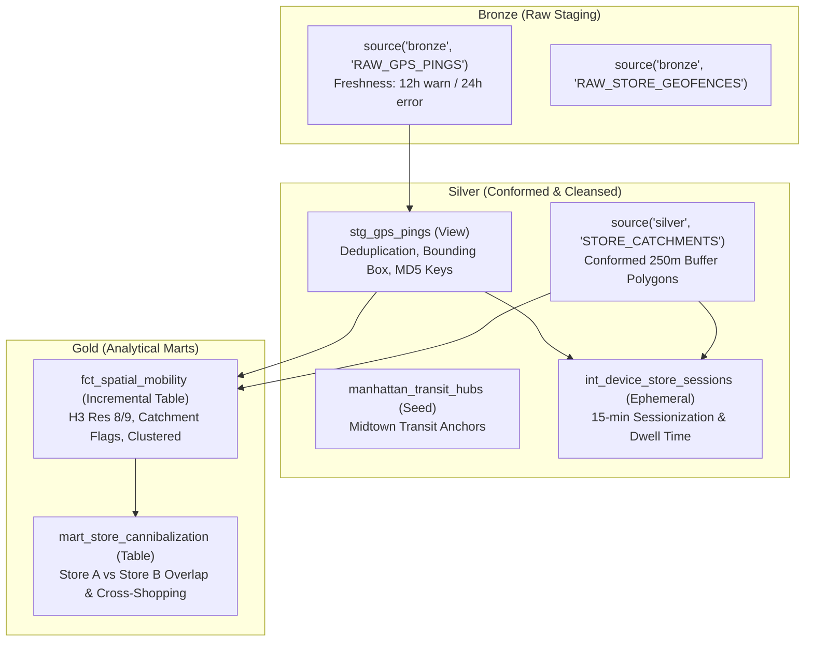

# GeoPulse Mobility Analytics — dbt Transformation Layer

This directory houses the **dbt (data build tool)** transformation pipeline for the **GeoPulse Retail Mobility Analytics** platform on **Snowflake**. It standardizes raw device telemetry, reconstructs shopping sessions, computes spatial indexing and catchment metrics, and produces analytical marts to quantify store foot traffic cannibalization.

---

## 1. Architecture & DAG Lineage

The transformation layer adheres to the **Medallion Architecture** pattern:



---

## 2. Model Directory & Materialization Strategy

| Layer | Model | Materialization | Snowflake Schema | Primary Key | Description |
| :--- | :--- | :--- | :--- | :--- | :--- |
| **Staging** | `stg_gps_pings` | `view` | `SILVER` | `ping_id` | Cleans, deduplicates raw pings, filters to Manhattan bounds `[40.70, 40.85]`, extracts date/hour/peak flags. |
| **Intermediate** | `int_device_store_sessions` | `ephemeral` | N/A (CTE) | `session_id` | Groups pings within 250m catchments into visits using a 15-minute inactivity threshold. |
| **Marts (Fact)**| `fct_spatial_mobility` | `incremental` | `GOLD` | `ping_id` | Spatially indexed fact table with H3 Res 8 & 9 indices, Haversine store distances, and cluster keys `(ping_date, h3_index_res9)`. |
| **Marts (Agg)** | `mart_store_cannibalization` | `table` | `GOLD` | `ping_date` | Daily overlap analysis measuring visitor cannibalization between Store A (Herald Sq) and Store B (5th Ave). |
| **Seeds** | `manhattan_transit_hubs` | `table` | `SILVER` | `hub_id` | Seed reference data containing major Midtown rail/subway transit hubs and ridership figures. |

---

## 3. Incremental Strategy & Performance

`fct_spatial_mobility` is configured with Snowflake's native `merge` incremental strategy:

```sql
{{
  config(
    materialized = 'incremental',
    unique_key = 'ping_id',
    incremental_strategy = 'merge',
    cluster_by = ['ping_date', 'h3_index_res9'],
    schema = 'GOLD'
  )
}}
```

- **Incremental Filter**:
  ```sql
  
  where ping_timestamp > (select coalesce(max(ping_timestamp), '1970-01-01'::timestamp_ntz) from {{ this }})
  
  ```
- **Clustering Key**: Clustered by `(ping_date, h3_index_res9)` to align Snowflake micro-partitions directly with spatial and temporal pruning dimensions.

---

## 4. Reusable Spatial Jinja Macros

Located in `dbt/macros/spatial_macros.sql`:

1. `calculate_haversine_meters(lat1, lon1, lat2, lon2)`
   - Computes great-circle spherical distance in meters:
   $$\text{dist} = 2 R \arcsin\left(\sqrt{\sin^2\left(\frac{\Delta \phi}{2}\right) + \cos(\phi_1)\cos(\phi_2)\sin^2\left(\frac{\Delta \lambda}{2}\right)}\right)$$
2. `assign_h3_res9(lat, lon)`
   - Calls native Snowflake `H3_POINT_TO_CELL_STRING(ST_POINT(lon, lat), 9)`.
3. `assign_h3_index(lat, lon, resolution)`
   - Parametric macro for arbitrary H3 resolutions (Res 7 through 10).
4. `classify_catchment_zone(dist_col, threshold=250.0)`
   - Evaluates boolean catchment membership based on radial buffer.
5. `is_in_bounding_box(lat_col, lon_col, min_lat, max_lat, min_lon, max_lon)`
   - Evaluates whether coordinates fall inside geographic bounds.

---

## 5. Seed Reference Data

- **File**: `dbt/seeds/manhattan_transit_hubs.csv`
- **Schema**:
  - `hub_id`: Unique identifier (e.g., `HUB_PENN_STATION`, `HUB_GRAND_CENTRAL`)
  - `hub_name`: Descriptive station name
  - `latitude`, `longitude`: WGS-84 coordinates
  - `hub_type`: Modal classification (`RAIL_COMMUTER_SUBWAY`, `INTERCITY_BUS_TRANSIT`)
  - `daily_ridership`: Estimated weekday passenger volume

---

## 6. Testing & Data Quality Framework

### Generic Schema Tests (`dbt/models/schema.yml`)
- **Uniqueness & Non-null**: Enforced across primary keys (`ping_id`, `session_id`, `ping_date`, `hub_id`).
- **Accepted Values**:
  - `ping_hour`: `[0..23]`
  - `nearest_store_id`: `['STORE_A_EXISTING', 'STORE_B_PROPOSED_5TH', 'STORE_C_ALT_WEST']`
  - `risk_classification`: `['HIGH_CANNIBALIZATION_RISK', 'MODERATE_CANNIBALIZATION_RISK', 'LOW_CANNIBALIZATION_EXPANSION']`

### Singular Custom Assertion (`dbt/tests/assert_valid_dwell_durations.sql`)
- Audits sessionization output to guarantee `dwell_duration_minutes` falls between `0.0` and `1440.0` minutes (24 hours). Returns any anomalous sessions.

### Source Freshness
- Configured in `dbt/models/staging/sources.yml` for `RAW_GPS_PINGS`:
  - `warn_after`: 12 hours
  - `error_after`: 24 hours

---

## 7. CLI Operational Guide

### 1. Install Dependencies
```bash
dbt deps
```

### 2. Load Seed Reference Datasets
```bash
dbt seed --select manhattan_transit_hubs
```

### 3. Check Source Freshness
```bash
dbt source freshness
```

### 4. Execute Full Transformation Pipeline
```bash
# Build staging views
dbt run --select staging

# Build and incrementally update fact tables
dbt run --select marts.fct_spatial_mobility

# Compute analytical cannibalization marts
dbt run --select marts.mart_store_cannibalization

# Or run all models end-to-end
dbt run
```

### 5. Execute Test Suite
```bash
# Run schema and custom data tests
dbt test

# Test specific model contracts
dbt test --select fct_spatial_mobility
dbt test --select assert_valid_dwell_durations
```
