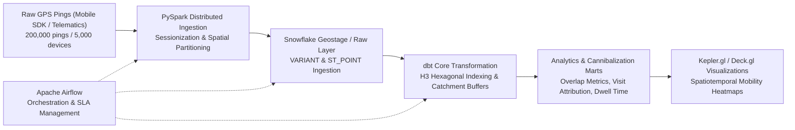

# GeoPulse: Retail Mobility & Foot-Traffic Analytics Architecture

## 1. Executive Summary & Problem Context
GeoPulse is an enterprise-scale geospatial data engineering and mobility intelligence platform designed to evaluate retail footprint performance, store cannibalization risks, and catchment dynamics in dense urban corridors. 

This implementation models foot-traffic dynamics across Midtown Manhattan for three strategic retail locations:
- **`STORE_A_EXISTING`** (Herald Square / 34th St Flagship): Lat `40.7549`, Lon `-73.9840`
- **`STORE_B_PROPOSED_5TH`** (Fifth Avenue Luxury Corridor): Lat `40.7565`, Lon `-73.9815`
- **`STORE_C_ALT_WEST`** (West Midtown / Penn District Alternative): Lat `40.7510`, Lon `-73.9930`

The primary objective is evaluating whether opening `STORE_B_PROPOSED_5TH` introduces severe foot-traffic cannibalization against `STORE_A_EXISTING` due to high commuter overlap during peak morning transit windows (07:00–09:59).

---

## 2. End-to-End Architecture Pipeline

### Component Breakdown
1. **`pyspark/` (Data Synthesis & Ingestion Engine)**:
   - High-throughput simulation of mobile device mobility patterns with realistic spatial clustering (Gaussian displacement around store anchors with $\sigma = 0.0025$) and commuter corridor transitions.
   - Scalable sessionization, outlier filtration, and geospatial trajectory preprocessing.
2. **`snowflake/` (Cloud Data Warehouse & Spatial Engine)**:
   - Ingestion pipelines leveraging Snowflake's native geospatial capabilities (`GEOGRAPHY`, `ST_POINT`, `ST_BUFFER`, `ST_DISTANCE`, `ST_INTERSECTS`).
3. **`dbt/` (Transformation & Analytics Modeling)**:
   - Multi-tier modeling (`staging`, `intermediate`, `marts`):
     - `stg_gps_pings`: Cleansed and timestamp-aligned coordinate streams.
     - `int_geofence_visits`: Spatial join against 250m circular catchment zones using H3 indices (resolution 8 & 9).
     - `fct_store_cannibalization`: Cross-store commuter overlap matrices during morning peak hours.
4. **`airflow/` (Pipeline Orchestration)**:
   - Scheduled DAGs handling raw ping batch loading, dbt run invocations, data freshness checks, and anomaly detection.
5. **`frontend/kepler-app/` (Interactive Geospatial Visualization)**:
   - Production-grade Kepler.gl / Mapbox integration rendering 3D hexbins, store catchment radius polygons (250m), and device commuter vector arcs.
6. **`docs/` (System Specifications & Schemas)**:
   - Architectural blueprints, data dictionary, H3 resolution trade-offs, and cannibalization scoring methodologies.

---

## 3. Spatial Catchment & Cannibalization Methodology
- **Catchment Radius**: 250 meters target radius ($\approx 0.00225^\circ$ latitude displacement) representing immediate walking catchment.
- **Commuter Overlap Window**: 07:00–09:59 EST (transit peak), identifying devices registered in both `STORE_A_EXISTING` and `STORE_B_PROPOSED_5TH` catchment envelopes within the same morning window.
- **Cannibalization Ratio**:
  $$\text{Cannibalization Ratio} = \frac{|D_A \cap D_B|}{|D_A|}$$
  where $D_A$ is the set of unique devices visiting Store A and $D_B$ is the set visiting Store B during peak hours.
