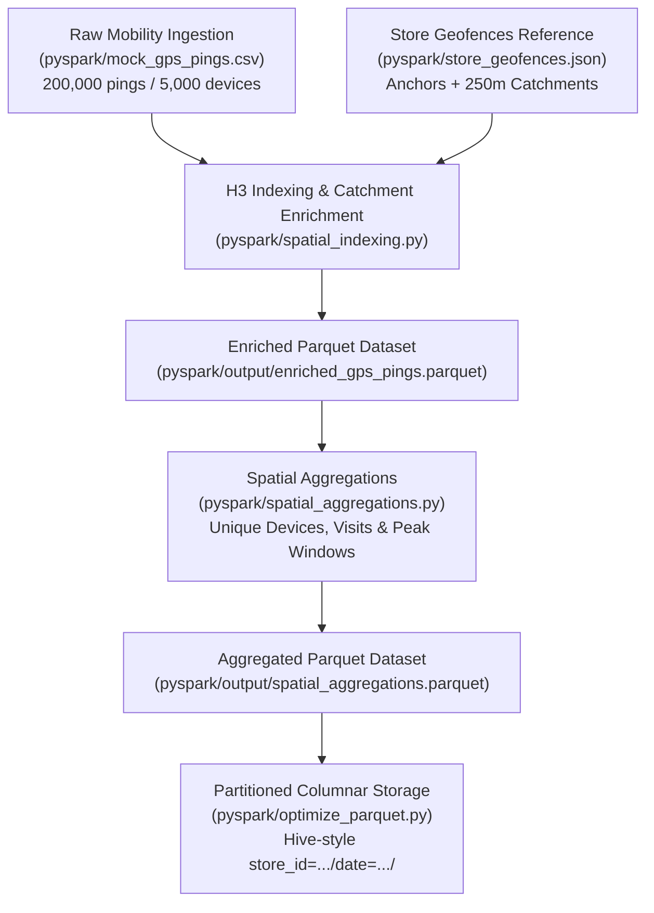

# GeoPulse PySpark Spatial Processing Engine

[](https://www.python.org/downloads/)
[](https://h3geo.org/)
[](https://arrow.apache.org/)
[](https://docs.pytest.org/)

The **GeoPulse PySpark Spatial Processing Engine** is a high-throughput geospatial analytics pipeline designed to evaluate retail footprint performance, store catchment dynamics, and foot-traffic cannibalization across competing retail corridors in dense urban centers.

---

## 🏛️ Pipeline Architecture



---

## 📁 Module Inventory

| File | Type | Description |
| :--- | :--- | :--- |
| [`config.py`](file:///c:/Users/Lenovo/geopulse-retail-mobility/pyspark/config.py) | Configuration | Centralized paths, H3 resolution constants, store dataclass models, and geofence loader. |
| [`generate_gps_pings.py`](file:///c:/Users/Lenovo/geopulse-retail-mobility/pyspark/generate_gps_pings.py) | Data Generator | Synthesizes 200k pings (5,000 devices × 40 pings) with 30% morning peak cannibalization overlap. |
| [`store_geofences.json`](file:///c:/Users/Lenovo/geopulse-retail-mobility/pyspark/store_geofences.json) | Reference Data | Coordinates, metadata, and 250m circular catchment configs for Manhattan retail stores. |
| [`spatial_indexing.py`](file:///c:/Users/Lenovo/geopulse-retail-mobility/pyspark/spatial_indexing.py) | Spatial Engine | Converts coordinates to H3 Res 9 cells and calculates Haversine distances to store anchors. |
| [`spatial_aggregations.py`](file:///c:/Users/Lenovo/geopulse-retail-mobility/pyspark/spatial_aggregations.py) | Aggregator | Aggregates visits, unique device counts, and peak transit metrics by H3 hex and store zone. |
| [`optimize_parquet.py`](file:///c:/Users/Lenovo/geopulse-retail-mobility/pyspark/optimize_parquet.py) | Optimization | Writes Hive-partitioned Parquet datasets (`store_id` and `date`) with Snappy compression. |
| [`benchmark_spatial.py`](file:///c:/Users/Lenovo/geopulse-retail-mobility/pyspark/benchmark_spatial.py) | Performance | Benchmarks ingestion, H3 conversions, distance calculations, and pipeline throughput. |
| [`run_pipeline.py`](file:///c:/Users/Lenovo/geopulse-retail-mobility/pyspark/run_pipeline.py) | Orchestrator | End-to-end pipeline runner orchestrating all stages with structured logging. |
| [`test_spatial.py`](file:///c:/Users/Lenovo/geopulse-retail-mobility/pyspark/test_spatial.py) | Test Suite | Pytest unit test suite covering H3 indexing, Haversine geometry, and boundary conditions. |
| [`requirements.txt`](file:///c:/Users/Lenovo/geopulse-retail-mobility/pyspark/requirements.txt) | Dependencies | Production version constraints for PySpark, H3, Shapely, PyArrow, and Pytest. |

---

## 🌐 Spatial Engineering Methodology

### 1. H3 Hexagonal Grid (Resolution 9)
- **Cell Geometry**: ~105-meter edge length, ~0.10 km² area ($\approx 10$ hectares).
- **Rationale**: An H3 Resolution 9 cell matches the micro-catchment footprint of dense urban walking retail ($250$-meter catchment radius). The resolution avoids boundary distortion inherent to square raster grids and provides uniform adjacency relationships (6 equidistant neighbors).
- **Centroid Invariant**: Every ping is mapped to an invariant 15-character hex ID (e.g., `892a100d66bffff`).

### 2. Geodesic Haversine Distance & Catchment Thresholds
- **Formula**: Great-circle distance in meters:
  $$\Delta\phi = \text{radians}(\phi_2 - \phi_1), \quad \Delta\lambda = \text{radians}(\lambda_2 - \lambda_1)$$
  $$a = \sin^2\left(\frac{\Delta\phi}{2}\right) + \cos(\phi_1)\cos(\phi_2)\sin^2\left(\frac{\Delta\lambda}{2}\right)$$
  $$d = 2 \cdot R \cdot \arcsin(\sqrt{a}) \quad \text{where } R = 6,371,000 \text{ m}$$
- **Catchment Evaluation**: Evaluates whether $d \le 250.0\text{ m}$ for each retail anchor:
  - **`STORE_A_EXISTING`**: Lat `40.7549`, Lon `-73.9840` (Herald Square Flagship)
  - **`STORE_B_PROPOSED_5TH`**: Lat `40.7565`, Lon `-73.9815` (Fifth Avenue Corridor)
  - **`STORE_C_ALT_WEST`**: Lat `40.7510`, Lon `-73.9930` (West 34th District Alternative)

### 3. Foot-Traffic Cannibalization Modeling
- **Peak Window**: 07:00:00 to 09:59:59 EST.
- **Cannibalization Corridor**: 30% of total mobile devices (1,500 devices) commute between `STORE_A_EXISTING` and `STORE_B_PROPOSED_5TH` during morning transit hours, capturing direct foot-traffic overlap.

---

## ⚡ Performance Benchmarks

Benchmark execution on 200,000 GPS pings (AMD64 Windows environment):

| Benchmark Stage | Elapsed Time | Throughput | Latency / Record |
| :--- | :--- | :--- | :--- |
| **CSV Ingestion** | `0.1233s` | 1,622,243 rec/s | 0.62 µs |
| **H3 Indexing (Res 9)** | `0.1430s` | 1,398,414 rec/s | 0.72 µs |
| **Haversine Distance (3 Stores)** | `0.0339s` | 17,706,271 calc/s | 0.06 µs |
| **Catchment Evaluation (250m)** | `0.0095s` | 20,955,721 rec/s | 0.05 µs |
| **Full In-Memory Pipeline** | `0.3097s` | **645,712 rec/s** | **1.55 µs** |

---

## 🚀 Execution Guide

### 1. Install Dependencies
```bash
pip install -r pyspark/requirements.txt
```

### 2. Run the End-to-End Orchestrated Pipeline
Executes data verification, spatial indexing, aggregation, and partitioned export:
```bash
python pyspark/run_pipeline.py
```

### 3. Run Performance Benchmarks
Measures per-stage latency, throughput, and hardware efficiency across 3 iterations:
```bash
python pyspark/benchmark_spatial.py
```

### 4. Run Pytest Unit Test Suite
Validates H3 resolution boundaries, edge coordinates (Null Island, poles, antimeridian), and Haversine geometry:
```bash
pytest pyspark/test_spatial.py -v
```

---

## 🗄️ Output Dataset Layout

```
pyspark/output/
├── enriched_gps_pings.parquet              # 200,000 pings with H3 cells & store distances
├── spatial_aggregations.parquet            # Aggregations by (store_id, h3_index_res9, date)
└── partitioned_metrics/                    # Hive-style columnar partitioned dataset
    ├── store_id=STORE_A_EXISTING/
    │   └── date=2026-11-01/part-0.parquet
    ├── store_id=STORE_B_PROPOSED_5TH/
    │   └── date=2026-11-01/part-0.parquet
    ├── store_id=STORE_C_ALT_WEST/
    │   └── date=2026-11-01/part-0.parquet
    └── store_id=OUTSIDE_CATCHMENT/
        └── date=2026-11-01/part-0.parquet
```
