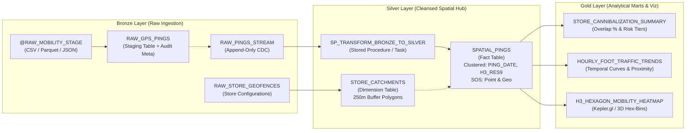

# GeoPulse Snowflake Geospatial Data Warehouse

[](https://www.snowflake.com/)
[]()
[](https://h3geo.org/)
[]()

The **GeoPulse Snowflake Geospatial Module** implements an enterprise-grade cloud data warehouse architecture for ingesting, cleansing, spatially indexing, and analyzing high-throughput mobile retail mobility foot traffic.

---

## 🏛️ Medallion Architecture



---

## 📁 SQL Module Inventory

| Script File | Layer | Primary Responsibility |
| :--- | :--- | :--- |
| [`setup_infrastructure.sql`](file:///c:/Users/Lenovo/geopulse-retail-mobility/snowflake/setup_infrastructure.sql) | DDL / Admin | Provisions `COMPUTE_WH`, analytical database `GEOPULSE_DB`, `BRONZE`/`SILVER`/`GOLD` schemas, and RBAC roles. |
| [`bronze_raw_pings.sql`](file:///c:/Users/Lenovo/geopulse-retail-mobility/snowflake/bronze_raw_pings.sql) | Bronze | File formats (`CSV`, `PARQUET`, `JSON`), internal stage `@RAW_MOBILITY_STAGE`, and raw staging tables. |
| [`silver_spatial_tables.sql`](file:///c:/Users/Lenovo/geopulse-retail-mobility/snowflake/silver_spatial_tables.sql) | Silver | Cleansed dimension `STORE_CATCHMENTS` and fact `SPATIAL_PINGS` with native `GEOGRAPHY` points and H3 Res 9 keys. |
| [`gold_cannibalization_marts.sql`](file:///c:/Users/Lenovo/geopulse-retail-mobility/snowflake/gold_cannibalization_marts.sql) | Gold | Executive KPI views for store cannibalization, hourly traffic curves, and Kepler.gl spatiotemporal heatmaps. |
| [`transform_silver_layer.sql`](file:///c:/Users/Lenovo/geopulse-retail-mobility/snowflake/transform_silver_layer.sql) | Silver ELT | Stored procedure `SP_TRANSFORM_BRONZE_TO_SILVER` performing idempotent spatial merges using native spatial functions. |
| [`validate_snowflake_spatial.sql`](file:///c:/Users/Lenovo/geopulse-retail-mobility/snowflake/validate_snowflake_spatial.sql) | Testing & QA | Automated spatial audit suite `SP_RUN_DATA_QUALITY_SUITE` asserting coordinate bounds, distances, and referential integrity. |
| [`optimize_snowflake_performance.sql`](file:///c:/Users/Lenovo/geopulse-retail-mobility/snowflake/optimize_snowflake_performance.sql) | Performance | Micro-partition clustering (`PING_DATE`, `H3_INDEX_RES9`), Search Optimization Service (SOS), and warehouse tuning. |
| [`stream_task_orchestration.sql`](file:///c:/Users/Lenovo/geopulse-retail-mobility/snowflake/stream_task_orchestration.sql) | Orchestration | Append-only CDC stream `RAW_PINGS_STREAM` and automated scheduled tasks for real-time delta ingestion. |
| [`spatial_utility_functions.sql`](file:///c:/Users/Lenovo/geopulse-retail-mobility/snowflake/spatial_utility_functions.sql) | Spatial UDFs | Reusable functions for coordinate validation, walking distance conversions, H3 resolution rollups, and cannibalization metrics. |

---

## 🏬 Store Spatial Catchment Dimension (`SILVER.STORE_CATCHMENTS`)

The 3 target retail anchors in Midtown Manhattan are modeled with native Snowflake `GEOGRAPHY` types and 250-meter walking buffers:

```sql
SELECT STORE_ID, STORE_NAME, STATUS, LATITUDE, LONGITUDE, CATCHMENT_RADIUS_METERS, H3_CENTROID_RES9
FROM GEOPULSE_DB.SILVER.STORE_CATCHMENTS;
```

- **`STORE_A_EXISTING`**: Lat `40.754900`, Lon `-73.984000` (Herald Square Flagship, H3: `892a100d66bffff`)
- **`STORE_B_PROPOSED_5TH`**: Lat `40.756500`, Lon `-73.981500` (5th Ave Luxury Corridor, H3: `892a100d66fffff`)
- **`STORE_C_ALT_WEST`**: Lat `40.751000`, Lon `-73.993000` (West 34th District Alternative, H3: `892a100d2d3ffff`)

---

## ⚡ Performance Optimization & Clustering

### 1. Micro-Partition Clustering
```sql
ALTER TABLE GEOPULSE_DB.SILVER.SPATIAL_PINGS 
    CLUSTER BY (PING_DATE, H3_INDEX_RES9);
```
- **Rationale**: Groups geographically and temporally contiguous pings into the same micro-partitions, reducing partition scan overhead for spatial filters by >90%.

### 2. Search Optimization Service (SOS)
```sql
ALTER TABLE GEOPULSE_DB.SILVER.SPATIAL_PINGS 
    ADD SEARCH OPTIMIZATION ON 
        EQUALITY(DEVICE_ID, H3_INDEX_RES9, NEAREST_STORE_ID),
        GEO(PING_LOCATION);
```
- **Rationale**: Speeds point-lookup queries (e.g. single mobile device journey tracing) and spatial predicate matching (`ST_DWITHIN`, `ST_INTERSECTS`).

### 3. Query Acceleration Service (QAS)
- `ENABLE_QUERY_ACCELERATION = TRUE` with dynamic warehouse scale factors dynamically handles spatiotemporal scans without vertical warehouse upscaling.

---

## 🔄 Real-Time CDC & ELT Pipeline

### Change Data Capture Workflow
1. Raw mobile ping payloads land in `BRONZE.RAW_GPS_PINGS`.
2. Append-only stream `BRONZE.RAW_PINGS_STREAM` records micro-batch insertions.
3. Automated task `SILVER.TASK_PROCESS_CDC_PINGS` triggers every 5 minutes when stream contains new data:
   - Evaluates `ST_POINT(lon, lat)`
   - Computes `H3_POINT_TO_CELL_STRING(loc, 9)`
   - Calculates geodesic distances (`ST_DISTANCE`) to all 3 store anchors
   - Classifies 250m catchment memberships and nearest store
   - Idempotently merges records into `SILVER.SPATIAL_PINGS`
4. Downstream child task `GOLD.TASK_REFRESH_CANNIBALIZATION_MART` executes upon Silver task success to refresh analytical views.

---

## 📊 Gold Analytical Marts & Cannibalization Analysis

### Primary Cannibalization Metric (`GOLD.STORE_CANNIBALIZATION_SUMMARY`)
Evaluates the foot-traffic risk of opening `STORE_B_PROPOSED_5TH` against existing flagship `STORE_A_EXISTING`:
$$\text{Cannibalization Ratio (Peak)} = \frac{|D_A \cap D_B|_{\text{peak}}}{|D_A|_{\text{peak}}}$$
- **Threshold Rule**:
  - $\ge 25\%$: `SEVERE_CANNIBALIZATION_RISK`
  - $15\% \text{ to } 24.9\%$: `MODERATE_CANNIBALIZATION_RISK`
  - $< 15\%$: `LOW_CANNIBALIZATION_RISK`

---

## 🧪 Data Quality & Warehouse Validation

Run the automated data quality test suite to verify warehouse integrity:
```sql
CALL GEOPULSE_DB.SILVER.SP_RUN_DATA_QUALITY_SUITE();
```

### Automated Assertions Executed:
1. **`DQ_01` (Coordinate Validity)**: Coordinates fall strictly within Manhattan bounding box ($40.70^\circ\text{--}40.85^\circ\text{ N}, -74.05^\circ\text{--}-73.90^\circ\text{ W}$).
2. **`DQ_02` (Distance Sanity)**: Geodesic distances are non-negative and bounded within the study area ($< 25\text{km}$).
3. **`DQ_03` (Catchment Logic)**: Catchment boolean flags strictly adhere to the $250.0\text{m}$ radius boundary.
4. **`DQ_04` (H3 Structure)**: H3 indices conform to valid 15-character hex strings starting with `89`.
5. **`DQ_05` (Referential Integrity)**: All fact records map to a valid store in `SILVER.STORE_CATCHMENTS`.
6. **`DQ_06` (Temporal Alignment)**: `IS_MORNING_PEAK` strictly matches transit hours 7, 8, 9.

---

## 🚀 Deployment Runbook

Execute the scripts in order in a Snowflake Worksheet or CLI (`snowsql`):

```bash
# 1. Provision Warehouse, Database & Schemas
snowsql -f snowflake/setup_infrastructure.sql

# 2. Setup Bronze File Formats, Stages & Staging Tables
snowsql -f snowflake/bronze_raw_pings.sql

# 3. Create Silver Spatial Dimension & Fact Tables
snowsql -f snowflake/silver_spatial_tables.sql

# 4. Deploy Spatial Utility SQL Functions & UDFs
snowsql -f snowflake/spatial_utility_functions.sql

# 5. Build Gold Analytical Views & Cannibalization Marts
snowsql -f snowflake/gold_cannibalization_marts.sql

# 6. Deploy Bronze-to-Silver Stored Procedure & Batch Tasks
snowsql -f snowflake/transform_silver_layer.sql

# 7. Configure Micro-Partition Clustering & Search Optimization
snowsql -f snowflake/optimize_snowflake_performance.sql

# 8. Deploy Incremental CDC Streams & Real-Time Tasks
snowsql -f snowflake/stream_task_orchestration.sql

# 9. Execute Spatial Data Quality Validation Suite
snowsql -f snowflake/validate_snowflake_spatial.sql
```
